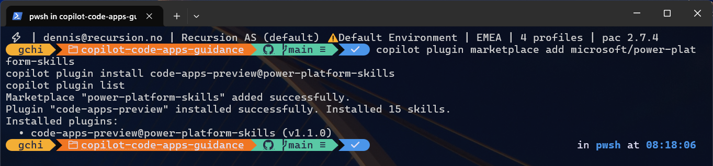
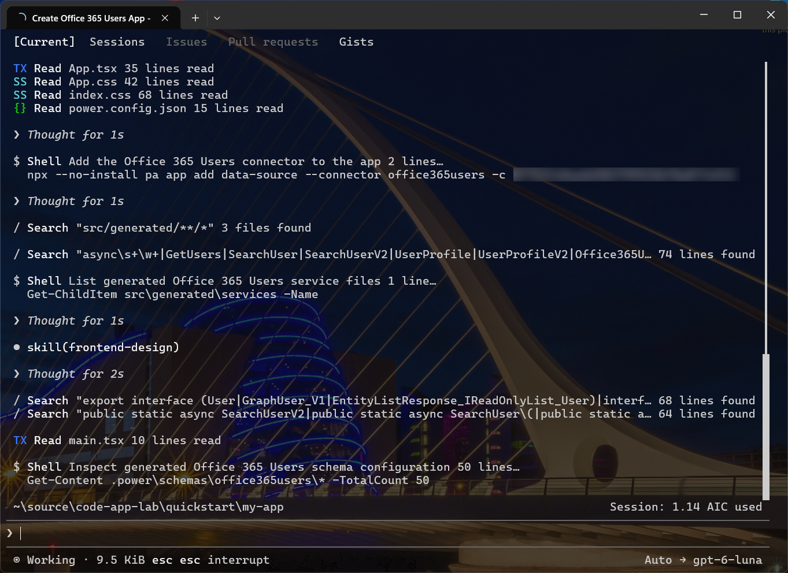
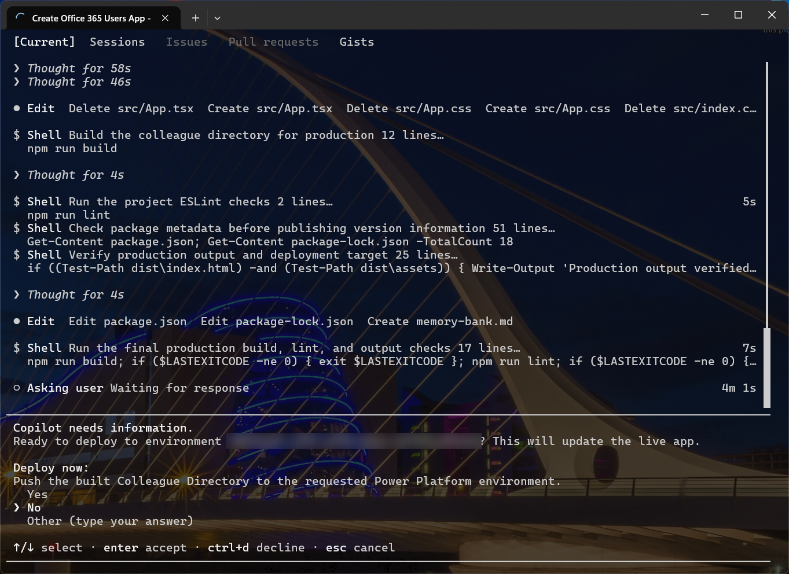
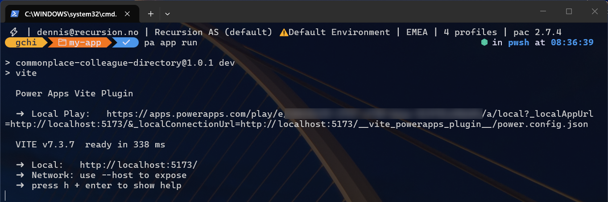
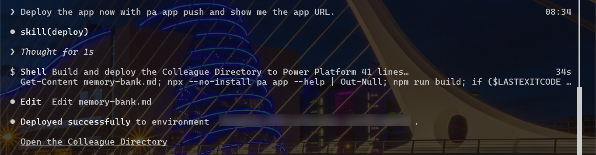

# Hurtigstart: fra tom mappe til publisert Code App med Copilot CLI

**Hvem denne siden er for:** utvikleren som har gjort [Oppsett av maskinen](oppsett-maskin.md) og vil se hele løpet én gang før den daglige loopen. Alt under er kjørt i en lab 2026-10-24 med Copilot CLI 1.0.61, `pa` 1.3.0 og pluginen `code-apps-preview` 1.1.0, og terminalbildene er fra den kjøringen. Siden følger Microsoft Learns quickstart steg for steg, med det som faktisk skjedde i terminalen.

!!! warning "Før du starter"
    Du trenger et miljø der **Enable code apps** er på, maker-rolle i det miljøet, og miljø-ID-en. Finn ID-en i maker-portalen under **Session details**, eller be admin. Uten den stopper steg 4. Se [Hvem får bygge](../styring/hvem-faar-bygge.md).

## Steg 1: installer pluginen

Utenfor en Copilot-økt:

```bash
copilot plugin marketplace add microsoft/power-platform-skills
copilot plugin install code-apps-preview@power-platform-skills
```

Sjekk: `copilot plugin list` viser `code-apps-preview@power-platform-skills`. Start Copilot på nytt hvis økten var åpen.



## Steg 2: start Copilot i en tom mappe

```bash
mkdir my-app && cd my-app
copilot
```

Sjekk: prompten viser Copilot-økten, og `/plugin` lister pluginen som aktiv.

## Steg 3: kjør `create-app`-skillen

```text
/code-apps-preview:create-app
```

Agenten sjekker først forutsetningene: Node, `pa`, innlogging mot riktig tenant. Mangler noe, installerer eller forklarer den. Så ber den deg beskrive appen.

Sjekk: agenten bekrefter at forutsetningene er på plass og spør hva du vil bygge.

## Steg 4: beskriv appen, med miljø-ID

Skriv på engelsk, konkret, og ta med miljøet. Eksempelet fra laben:

```text
Create an app that shows my colleagues from Office 365 Users in a searchable list.
Selecting a person shows their name, title, department, e-mail and phone.
Deploy to environment: <environment-id>
```

Agenten går rett på: den leser pluginens egne instruksjoner, lister connections i miljøet, scaffolder prosjektet fra Vite-malen, kjører `pa app init` mot miljøet og `pa app add data-source` for Office 365 Users-connectoren. I laben stilte den ingen oppfølgingsspørsmål; beskrivelsen over var nok.

Sjekk: den eneste connectoren den legger til, er den du ba om. Ser du en annen i terminalen, trykk `esc` og si fra.



## Steg 5: se på mens den skriver, bygger og spør

Agenten skriver `App.tsx` og stilene, kjører `npm run build` og `npm run lint`, og sjekker at `dist/` finnes. Så stopper den og spør om den skal deploye til miljøet. Det er det ene spørsmålet du får i hele løpet, og det er bevisst: deploy endrer noe utenfor maskinen din.

Sjekk: mappen har `power.config.json`, `src/generated/` med typet tjeneste for connectoren, `.power/schemas/` og `src/` med appen. Ingen hemmeligheter i noen av filene. Ikke svar ja ennå; kjør appen lokalt først (steg 6).



## Steg 6: kjør lokalt

I en annen terminal, i appmappen:

```bash
pa app run
```

Vite-pluginen skriver ut en **Local Play**-URL. Åpne den i samme nettleserprofil som du er logget inn i Power Platform med. Første gang spør nettleseren om tilgang til lokalt nettverk; godta.

Sjekk: appen vises i Power Apps-spilleren med data fra tenanten din. Lokalt er det din egen bruker som henter dataene.



## Steg 7: publiser

Tilbake i Copilot: velg **Yes** på spørsmålet fra steg 5, eller skriv «Deploy the app now with pa app push». Agenten bygger på nytt og kjører `pa app push`. Vil du heller gjøre det selv:

```bash
npm run build
pa app push
```

Sjekk: agenten svarer «Deployed successfully to environment …» med en lenke til appen. Åpne make.powerapps.com, velg miljøet, og se appen under Apps med typen Code. I laben fikk den navnet Colleague Directory, satt av agenten ut fra beskrivelsen.



## Steg 8: del appen

```bash
pa app share --principal <bruker@organisasjon.no> --access play
```

Eller del fra maker-portalen som for andre apper. Brukeren trenger Power Apps Premium, pay-as-you-go eller App Pass, og egen tilgang til datakilden.

Sjekk: brukeren åpner URL-en og ser appen. Første gang får brukeren et samtykkevindu som lister connectorene appen bruker.

## Hva som nettopp skjedde

Du skrev ingen scaffold, ingen datakobling og ingen deploy-kommando selv. Legg også merke til at agenten brukte `npx --no-install pa …`, altså prosjektets egen kopi av CLI-en, ikke den globale; begge virker. Copilot kjørte `pa`-CLI-en, og Power Platform ga appen identitet, DLP, revisjonslogg, telemetri og deling. Det er fordelingen i resten av veiledningen: agenten skriver, plattformen håndhever, du reviewer.

## Hvis noe feilet

| Melding | Betyr | Gjør |
|---|---|---|
| Code apps er ikke aktivert i miljøet | **Enable code apps** er av | Admin slår på; se [Hvem får bygge](../styring/hvem-faar-bygge.md) |
| Connectoren kan ikke brukes / DLP-konflikt | Connectoren er blokkert i miljøet | Velg en tillatt connector, eller be admin; se [DLP og Code Apps](../sikkerhet/dlp-og-code-apps.md) |
| Tom app i Local Play | Nettleseren blokkerer lokalt nettverk | Godta spørsmålet om Local Network Access |
| `pa` finnes ikke | CLI-en er ikke installert globalt | `npm install --global @microsoft/power-apps-cli` |
| Agenten foreslår `npx power-apps` eller `pac code` | Gammel kunnskap i modellen | Si at CLI-en er `pa`, og legg det i [instruksjonsfilen](instructions-og-agents.md) |

## Claude Code

Samme plugin, samme skill-navn og samme prompt fungerer i Claude Code: start `claude` i stedet for `copilot`. Resten av stegene er like.

## Neste steg

[Daglig loop](daglig-loop.md): det du gjør hver dag etter den første appen. [Instruksjonsfiler](instructions-og-agents.md): slik gjør du at agenten kjenner organisasjonens regler fra første prompt.

## Kilder

- Microsoft Learn, Quickstart: Build a code app with GitHub Copilot: https://learn.microsoft.com/power-apps/developer/code-apps/how-to/quickstart-github-copilot (lest 2026-10-23)
- Microsoft Learn, Power Apps CLI command reference: https://learn.microsoft.com/power-apps/developer/code-apps/reference/cli (lest 2026-10-23)
- Egen test 2026-10-23: Copilot CLI 1.0.61, `pa` 1.3.0, plugin `code-apps-preview` 1.1.0, Node 24.
