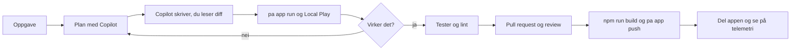

# Arbeidsflyt: utviklerens hverdag med Copilot og Code Apps

**Hvem denne delen er for:** utvikleren. Resten av veiledningen handler om beslutninger og styring. Denne delen handler om det som skjer i terminalen og i editoren, fra oppsett til publisert app, og om reglene som holder det trygt.

## Loopen i ett bilde

Copilot skriver kode og kjører kommandoer etter at du har godkjent planen. Plattformen avgjør om appen får kjøre: miljøet må ha Code Apps på, connectorene må være tillatt, brukerne må ha lisens. Review er din jobb, ikke Copilots.

## Sidene i rekkefølge

| Side | Svarer på |
|---|---|
| [Hurtigstart](hurtigstart.md) | Fra tom mappe til publisert app med Copilot CLI, med terminalbilde av hvert steg |
| [Oppsett av maskinen](oppsett-maskin.md) | Det som må være installert og innlogget før hurtigstarten |
| [Daglig loop](daglig-loop.md) | Oppgave, plan, prompt, review, test, push, i detalj |
| [Repo-konvensjoner](repo-konvensjoner.md) | Mappestruktur, hva som committes, branches, PR-mal |
| [Instruksjonsfiler](instructions-og-agents.md) | Hva som hører hjemme i `copilot-instructions.md` og `AGENTS.md` for en Code App |
| [Prompter](prompter.md) | Gjenbrukbare prompt-filer for vanlige oppgaver |
| [Skills og plugins](skills-og-plugins.md) | Power Platform Skills-markedsplassen og hvilken plugin som gjelder hvilken apptype |
| [Rammeverk](rammeverk.md) | React-malen og de andre Vite-rammeverkene som er testet |
| [Datakilder](datakilder.md) | Dataverse og SharePoint gjennom connectorer, delegering og grenser |
| [Review-regler](review-regler.md) | Hva du sjekker i kode Copilot har skrevet |
| [Grenser](grenser.md) | Hva Copilot ikke får gjøre i dette oppsettet |
| [Feilsøking](feilsoking.md) | Kjente feil og omveier |

## Versjonene denne delen er verifisert med

| Verktøy | Versjon | Dato |
|---|---|---|
| GitHub Copilot CLI | 1.0.61 | 2026-10-23 |
| `@microsoft/power-apps-cli` (`pa`) | 1.3.0 | 2026-10-23 |
| `@microsoft/power-apps` (SDK) | 1.5.0 | 2026-10-23 |
| `@microsoft/power-apps-vite` | 1.0.13 | 2026-10-23 |
| Plugin `code-apps-preview@power-platform-skills` | 1.1.0 | 2026-10-23 |
| Node.js | 24 LTS | 2026-10-23 |

Når én av disse får ny hovedversjon, kjøres hurtigstarten på nytt og tabellen oppdateres.
