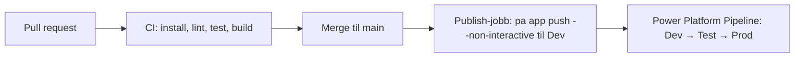

# CI/CD: bygg og publiser fra GitHub Actions

**Hvem denne siden er for:** arkitekten som setter opp pipelinen, og utvikleren som skal forstå hvorfor `pa app push` fra laptopen er sperret i sone 3. Oppsettet er lite: en service principal, én deling, fire miljøvariabler, én workflow.

!!! note "Til verifisering i lab"
    Kommandoene og miljøvariablene på denne siden er fra Learn (lest 2026-10-23). Workflow-filen er veiledningens eget forslag og er ikke kjørt mot en tenant ennå. Siden oppdateres med dato og eventuelle avvik når labkjøringen er gjort.

## Hva som skjer



GitHub Actions eier koden fram til Dev. Power Platform Pipelines eier promoteringen videre. Utviklere pusher aldri direkte til Test eller Prod.

## Forutsetninger, én gang

1. **App registration i Entra** med client secret. Noter Application (client) ID, Directory (tenant) ID, og Enterprise Application **object ID** (fra Enterprise applications, ikke App registrations; de er forskjellige).
2. **Tilgang til miljøet** for service principalen (Application User i målmiljøet).
3. **Første publisering gjøres av en maker**, interaktivt. Service principalen kan oppdatere en app, ikke opprette den første gangen.
4. **Deling med service principalen**, én gang, fra makerens maskin, ikke i pipelinen:

    ```console
    pa auth login --account <maker-epost>
    pa app share --principal <enterprise-application-object-id> --access edit
    ```

    Miljørettigheter alene gir ikke rett til å oppdatere appen; `edit`-delingen er det som gjør det.

5. **Secrets i GitHub**: `PA_CLI_SP_CLIENT_ID`, `PA_CLI_SP_CLIENT_SECRET`, `PA_CLI_SP_TENANT_ID` som repository eller environment secrets. Aldri i workflow-filen.

## Workflow-forslag

```yaml
name: publish-code-app
on:
  push:
    branches: [main]

jobs:
  publish:
    runs-on: ubuntu-latest
    environment: dev
    steps:
      - uses: actions/checkout@v4
      - uses: actions/setup-node@v4
        with:
          node-version: 22
          cache: npm
      - run: npm ci
      - run: npm test --if-present
      - run: npm run build
      - run: npm install -g @microsoft/power-apps-cli
      - name: Publish to Dev
        env:
          PA_CLI_USE_SP_AUTH: "true"
          PA_CLI_SP_CLIENT_ID: ${{ secrets.PA_CLI_SP_CLIENT_ID }}
          PA_CLI_SP_CLIENT_SECRET: ${{ secrets.PA_CLI_SP_CLIENT_SECRET }}
          PA_CLI_SP_TENANT_ID: ${{ secrets.PA_CLI_SP_TENANT_ID }}
          PA_CLI_ENVIRONMENT_ID: ${{ vars.PA_ENVIRONMENT_ID }}
          PA_CLI_SOLUTION_ID: ${{ vars.PA_SOLUTION_ID }}
        run: pa app push --non-interactive
```

Tre ting å merke seg:

- `PA_CLI_USE_SP_AUTH` må være strengen `true` i små bokstaver. `CI=true` fungerer også, men vær eksplisitt.
- Miljø-ID og solution-ID er ikke hemmeligheter; de kan ligge som variables. Solution-ID må være GUID.
- Pin CLI-versjonen (`@microsoft/power-apps-cli@<versjon>`) når pipelinen er stabil, og oppdater bevisst. [Oppdateringstakt](oppdateringstakt.md).

## Branch-beskyttelse

Pipelinen er bare så sikker som veien inn til `main`. Krev pull request med minst én reviewer, status checks for CI, og ingen direkte push. Det er også her [review-reglene](../arbeidsflyt/review-regler.md) for AI-skrevet kode håndheves: en agent kan åpne en pull request, men ikke merge den.

## Videre fra Dev

Solutionen med appen flyttes Dev → Test → Prod med Power Platform Pipelines, med godkjenning før Prod i sone 3. Det kan trigges fra maker-portalen eller automatiseres; se [ALM for Code Apps](alm-for-code-apps.md).

## Når det feiler

| Feil | Vanlig årsak |
|---|---|
| Push feiler med tilgangsfeil | Appen er ikke delt med service principalen med `edit`, eller feil object ID ble brukt |
| Push feiler på solution | ID-en er ikke en GUID, eller solutionen finnes ikke i målmiljøet |
| Push feiler i et miljø uten Dataverse | Fjern `PA_CLI_SOLUTION_ID`; appen publiseres uten solution, og kan da ikke promoteres |
| Push feiler med «code apps not enabled» | Environment group-regelen er av for miljøet. Se [Hvem får bygge](../styring/hvem-faar-bygge.md) |

## Neste steg

[ALM for Code Apps](alm-for-code-apps.md) for solution-mekanikken. [Identitet og tilgang](../sikkerhet/identitet-tilgang.md) for service principalens rettigheter.

## Kilder

- Microsoft Learn, Publish Power Apps code apps with a service principal: https://learn.microsoft.com/power-apps/developer/code-apps/how-to/use-service-principal (lest 2026-10-23)
- Microsoft Learn, Power Apps CLI environment variables: https://learn.microsoft.com/power-apps/developer/code-apps/reference/environment-variables (lest 2026-10-23)
- Microsoft Learn, ALM for code apps (solution targeting in CI/CD): https://learn.microsoft.com/power-apps/developer/code-apps/how-to/alm (lest 2026-10-23)
- Microsoft Learn, GitHub Actions for Microsoft Power Platform: https://learn.microsoft.com/power-platform/alm/devops-github-actions (lest 2026-10-23)
