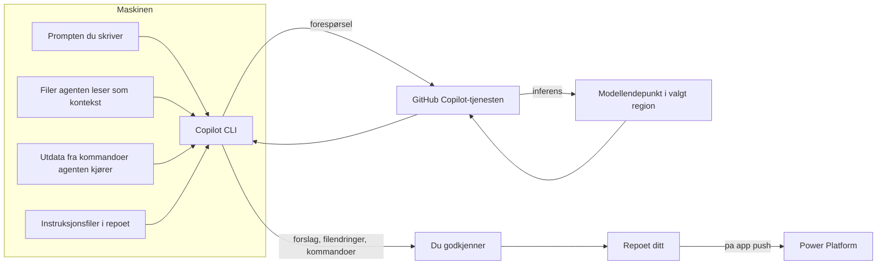

# Dataflyt til modellen: hva som forlater maskinen når utvikleren bruker Copilot

**Hvem denne siden er for:** sikkerhetsansvarlig, personvernombudet og utvikleren som vil vite hva som faktisk sendes. Mye av uroen rundt AI-verktøy kommer av at ingen har tegnet opp strømmen. Her er den, for Copilot CLI i et Code App-prosjekt.

## Strømmen

Det som går ut: prompten, de delene av koden agenten velger som kontekst, innholdet i instruksjonsfilene, og utdata fra kommandoer agenten kjører (for eksempel en feilmelding fra `npm run build` eller listen fra `pa connection list`). Det som ikke går ut: filer agenten ikke leser, og i Business og Enterprise brukes ikke forespørslene til å trene modeller.

Det som går ut i den andre strømmen, fra appen til Power Platform, er den kompilerte bunten ved `pa app push` og appens data gjennom connectorer ved kjøring. Den strømmen har ingenting med Copilot å gjøre, og den er lik for en app skrevet uten AI.

## Tre ting i strømmen som fortjener en regel

1. **Kommandoutdata.** Når agenten kjører `pa connection list` eller leser `power.config.json`, ser modellen miljø-ID-er og tilkoblings-ID-er. De er ikke hemmeligheter, men de er identifikatorer. Legg aldri inn ekte hemmeligheter i filer agenten kan lese; se [Hemmeligheter](hemmeligheter.md).
2. **Testdata.** En utvikler som limer inn en eksport fra Dataverse for å få agenten til å lage en tabell, har sendt persondata til en modell. Bruk syntetiske data, og skriv regelen i instruksjonsfilen.
3. **Instruksjonsfilene.** De sendes med hver forespørsel. Det er bra, det er derfor de virker, men de skal ikke inneholde interne URL-er, navn på kunder eller noe som ikke tåler å ligge i en prompt.

## Hva som styrer strømmen

| Hva | Hvor det styres | Gjelder CLI? |
|---|---|---|
| Om Copilot CLI er tillatt | Copilot in the CLI-policy | Ja |
| Hvilken region inferensen skjer i | Dataresidens i Copilot-innstillingene | Ja |
| Hvilke modeller | Modellpolicyer | Ja |
| Hvilke MCP-servere agenten får bruke | MCP-policy og register | Ja |
| Hvilke filer Copilot ikke får lese | Content exclusion | **Nei**, bare IDE |
| Hva agenten får kjøre og lese på maskinen | Utviklerens godkjenning per handling | Ja, men utvikleren kan slå det av |

[Copilot-policyer](copilot-policyer.md) beskriver innstillingene. Den siste raden er den viktigste: i terminalen er utvikleren siste skanse, og det er derfor [Grenser](../arbeidsflyt/grenser.md) finnes.

## For personvernombudet

Spørsmålene å stille, med sidene som har svarene: hvor behandles forespørslene ([GDPR og EU-datagrense](../norge/gdpr-og-eu-datagrense.md)), hva beholdes og hvor lenge (GitHubs dokumentasjon og Trust Center, lenket under), og hva gjør vi for at persondata ikke havner i prompter (opplæring, instruksjonsfiler, syntetiske testdata, R1 i [risikoregisteret](../strategi/risikoregister.md)).

## Neste steg

[Hemmeligheter](hemmeligheter.md): hvor de skal ligge i stedet. [Grenser](../arbeidsflyt/grenser.md): reglene for utvikleren.

## Kilder

- GitHub Docs, Administer Copilot CLI for your enterprise (hvilke policyer som gjelder CLI-en): https://docs.github.com/en/copilot/how-tos/copilot-cli/administer-copilot-cli-for-your-enterprise (lest 2026-10-23)
- GitHub Docs, Content exclusion: https://docs.github.com/en/copilot/concepts/security-governance-and-network-settings/content-exclusion (lest 2026-10-23)
- GitHub Copilot Trust Center: https://copilot.github.trust.page/ (les sammen med personvernombudet; oppdateres oftere enn denne siden)
- GitHub Changelog, Copilot data residency: https://github.blog/changelog/2026-04-13-copilot-data-residency-in-us-eu-and-fedramp-compliance-now-available (lest 2026-10-23)
